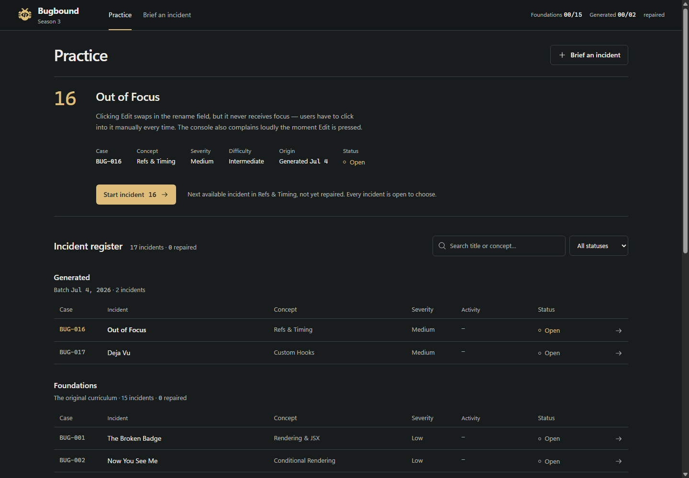

# Bugbound — Season 03

> **Learn React by fixing it — then brief your coding agent to plant the next bug.** An engineering lab of 17 intentionally broken React incidents (`15` Foundations + `2` Generated), plus a brief builder and repository skill for commissioning fresh, blind-mode debugging challenges from your own AI agent.

Bugbound is a local, editor-first React debugging game. Season 03 completes the three-season arc after [Bugbound Season 01](https://github.com/Brantley-Wyche/Bugbound-Season-1) (core React + TypeScript field notebook) and [Bugbound Season 02](https://github.com/Brantley-Wyche/Bugbound-Season-2) (Next.js App Router investigation desk): instead of working through a fixed campaign alone, you work in an **Engineering Lab** where every incident is open to choose, every check run is recorded as a measurement, and your browser's learning readings feed the next brief you hand to your AI coding agent.



> **Desktop-first by design.** Solving incidents requires a local code editor, Vite HMR, and a desktop browser running side by side. Phones and touch devices display a setup notice while still allowing you to browse the incident register, concept references, and brief builder.

---

## How it works

Every incident follows the same four-step loop — **Learn · Reproduce · Repair · Verify** — inside Season 03's Engineering Lab surfaces:

| Surface | Role in the loop |
|---|---|
| **The bench & Batch register (`#/`)** | Leads with the active **incident on the bench** (`Start` or `Continue incident NN`), prioritizing unrepaired generated practice before foundations. Below the bench, the **Incident register** groups **Generated** incidents by generation date (`Batch Jul 4, 2026 · 2 incidents`, newest batch first) followed by **Foundations** (`01`–`15`, directly reachable via `#/foundations`), with live search and status filtering (`All statuses`, `Open`, `Repaired`). Repairing the latest generated batch displays the **Batch record**; repairing all incidents displays the complete **Lab record**. |
| **Readings row & Section jumps** | Under each incident's two-digit folio and title, a ruled **Readings row** lists `Case` (`BUG-###`), `Concept`, `Severity`, `Difficulty` (generated incidents), `Origin` (`Generated <date>` or `Foundations`), and `Status` (`Open` or `Repaired <day>`), plus `Runs`, `Hints opened` (tier numbers), and `Last worked` once you begin. Section buttons jump focus directly to `Experiment`, `Verification`, or `Report & reference`. |
| **Incident report (`BUG-###`) & Source files** | Describes the observable symptom in QA-ticket style alongside copyable source file paths (with rolling clipboard feedback and a manual-copy fallback). Early incidents name exact files; later ones (`vague: true`) point to a folder to investigate. |
| **Concept reference** | A native disclosure (`<details open>`) kept expanded by default in the context column on desktop so you can read the underlying React mechanism while inspecting the live component. |
| **Live experiment & Instrument bar** | A framed same-origin preview iframe (`exercise.html`) with **Remount** (resets component state and increments the `Mount NN` counter) and **Focus experiment** / **Show context** (expands the experiment column while preserving the mounted preview and disclosure state). Pinned to the foot of the experiment column is the **Instrument bar**: `Run checks` / `Re-run checks` (<kbd>Ctrl+Enter</kbd> / <kbd>⌘ Enter</kbd> from anywhere on the page or inside the preview frame), `Cancel` during active runs, the **Bar trace** (the last 6 runs rendered as cell rows from the second run onward), a clickable run reading that scrolls to the run header, and `Next: NN …` (or `Brief an incident`) once repaired. |
| **Verification record (`Repaired`)** | Runs each check sequentially in a fresh disposable same-origin iframe (`src/shell/runtime/frame-check.js` + `src/shell/runtime/harness.jsx`), driving inputs via native property setters and asserting against the DOM. The first run that passes every check records a permanent **Repaired** entry (`BUG-### repaired today at … on run NN`), draws the teal rule across once, and provides an optional **Conclusion** field saved in the browser. |
| **Readings log & Hints** | Logs your first visit (`Opened`), every completed check run with its pass-count delta since the previous run (`+1 since Run 02`, `no change since Run 02`) and `· Repaired` marker, hint tiers opened (`Hint 01`–`03`, by tier number only — never hint text), and progress resets (`bugbound:learning:v1`). Three base64-encoded hints per incident (`Gentle nudge`, `Closer look`, and `Basically the answer`) stay concealed until you choose to reveal them. |
| **Brief an incident (`#/brief`)** | Pairs challenge settings (topic, `Intermediate` or `Hard` difficulty, `1`–`3` incidents, optional engineering context) with the exact prepared handoff prompt for your external coding agent. Includes a **From your readings** topic suggestion (the unrepaired concept with the most runs), a **Your readings** concept summary table, and an optional spoiler-free `bugbound-learning-profile.json` export. |

### Progress & persistence

- **Saved vs. verified:** Repairs are persisted to `localStorage` and synchronized across tabs using additive generation-scoped keys (`bugbound:progress:v2:`, `src/shell/progress/progress.js`). A recorded repair is history — re-running checks on a later visit tests the current source on disk (`Repaired <day> still stands`) without undoing your saved repair. Read, save, and reset failures surface an explicit recovery bar (`Retry reading progress`, `Retry saving`, `Retry reset`).
- **Readings (`bugbound:learning:v1`):** Stores the newest 50 events, lifetime run counters, hint tier numbers opened, and optional conclusions per incident (`src/shell/progress/learning.js`). Confirming **Reset repairs** in the footer starts a new progress generation and reopens all incidents while keeping your readings and conclusions intact.
- **Spoiler-free repository ("Blind mode"):** All hints in `src/levels/hints.json` and reference fixes in [`SOLUTIONS.md`](SOLUTIONS.md) are base64-encoded so searching the repo never spoils a bug.

---

## Curriculum (17 Shipped Incidents + Infinite Agent Generation)

**Why an Engineering Lab after Season 01 and Season 02?** Season 01 taught React's client-side runtime mental model across 15 guided incidents, and Season 02 moved across the server/client boundary in Next.js App Router. Season 03 is built for ongoing, self-directed mastery: every incident is unlocked from the start, the original 15 incidents remain browsable as **Foundations**, two agent-generated incidents ship in `src/levels/custom/` as the first batch, and the **Brief an incident** station lets you commission new batches tailored to the exact concepts where your readings show the most check runs or hints.

### Generated Batch (`Batch Jul 4, 2026` — `src/levels/custom/`)

| No. | ID | Incident | Concept | Difficulty | Severity | Checks |
|---|---|---|---|---|---|---:|
| `16` | `BUG-016` | **Out of Focus** | Refs & Timing | Intermediate | Medium | 4 |
| `17` | `BUG-017` | **Deja Vu** | Custom Hooks | Intermediate | Medium | 4 |

### Foundations — Act I: Core React (JavaScript)

| No. | ID | Incident | Concept | Severity | Checks |
|---|---|---|---|---|---:|
| `01` | `BUG-001` | **The Broken Badge** | Rendering & JSX | Low | 3 |
| `02` | `BUG-002` | **Now You See Me** | Conditional Rendering | Low | 3 |
| `03` | `BUG-003` | **Lost in Transit** | Props | Medium | 3 |
| `04` | `BUG-004` | **The Frozen Scoreboard** | State & Immutability | Medium | 3 |
| `05` | `BUG-005` | **Triple Trouble** | State Updates | Medium | 3 |
| `06` | `BUG-006` | **Musical Chairs** | Lists & Keys | High | 2 |
| `07` | `BUG-007` | **The Unresponsive Form** | Controlled Forms | Medium | 2 |
| `08` | `BUG-008` | **Stuck in the Past** | Effect Dependencies | High | 3 |
| `09` | `BUG-009` | **The Haunted Stopwatch** | Effect Cleanup | High | 3 |
| `10` | `BUG-010` | **Photo Finish** | Async & Race Conditions | Critical | 2 |
| `11` | `BUG-011` | **Out of the Loop** | Context | Medium | 3 |
| `12` | `BUG-012` | **The Render Storm** | Memoization & Renders | High | 3 |

### Foundations — Act II: The TypeScript Arc

| No. | ID | Incident | Concept | Severity | Checks |
|---|---|---|---|---|---:|
| `13` | `BUG-013` | **Any Port in a Storm** | TypeScript: Typing Data | High | 3 |
| `14` | `BUG-014` | **Hook, Line & Sinker** | TypeScript: Typing Hooks | Medium | 3 |
| `15` | `BUG-015` | **The Final Boss** | Capstone: Reducers + TS | Critical | 4 |

---

## Commissioning new incidents (Bring your own agent)

Open **Brief an incident** (`#/brief`) at any time to prepare a structured handoff prompt for your external AI coding agent (Claude Code, Cursor, Codex, etc.).

1. **Shape the brief:** Pick a practice topic (or select the chip under **From your readings**), choose `Intermediate` or `Hard`, select `1`–`3` incidents, optionally add engineering scenario constraints, and optionally download `bugbound-learning-profile.json` to attach to your agent.
2. **Hand off to your agent:** Your agent reads [`AGENTS.md`](AGENTS.md) and [`.claude/skills/bugbound-levelsmith/SKILL.md`](.claude/skills/bugbound-levelsmith/SKILL.md), creates a generation branch, authors the buggy component(s) and `manifest.js` under `src/levels/custom/<NN-slug>/`, and encodes three hints into `src/levels/hints.json` plus a reference fix into [`SOLUTIONS.md`](SOLUTIONS.md) using `npm run encode -- "text"`.
3. **Red-before / green-after proof:** Before handing the repository back, the agent must run `npm run verify-level -- <id>` to prove the checks fail against the planted bug and pass against a privately applied fix — then restore the buggy version, discard the fix, and pass `npm run validate-levels`, `npm test`, and `npm run build`.

Manage generated levels from the terminal at any time:

```bash
npm run custom-levels -- list
npm run custom-levels -- remove 16-out-of-focus --confirm
npm run custom-levels -- reset --confirm
```

---

## Getting started

Requires **Node.js `^20.19.0 || >=22.12.0`** and **npm `^11.16.0`**.

```bash
git clone https://github.com/Brantley-Wyche/Bugbound-Season-3.git bugbound-season-3
cd bugbound-season-3
git checkout -b playthrough
npm ci
npm run dev
```

Open `http://localhost:5173`, pick up the incident on the bench (or choose any incident from the register), and keep your editor open beside the browser.

## House rules

- **Keep your exercise edits in `src/levels/`.** `src/shell/` is the game engine and is bug-free by design.
- **Keep `data-testid` attributes and `manifest.js` checks intact** — they are the executable specification. Reading a level's `manifest.js` when stuck is fair game, just like reading a failing test suite at work.
- **Keep `main` pristine — it's the game cartridge.** Play on your own branch and commit your fixes there:

  ```bash
  git checkout -b playthrough
  ```

  Your commits become a log of what you repaired. To reset a single incident back to its broken starting state, run `git restore --source=main src/levels/06-musical-chairs/`. Browser completion is separate: use **Reset repairs** in the footer (which confirms inline, supports <kbd>Escape</kbd> to cancel, and keeps your readings and conclusions intact).
- **Using an AI coding assistant?** Ask it to **coach, not solve** — [`AGENTS.md`](AGENTS.md) instructs assistants to respect blind mode.

---

## Architecture & tech notes

- **React 19 + Vite 7 + project CSS + installed beUI motion components.** The shell implements the **Engineering Lab** system documented in [`DESIGN.md`](DESIGN.md), [`FAMILY.md`](FAMILY.md), and [`docs/ARCHITECTURE.md`](docs/ARCHITECTURE.md): warm graphite surfaces (`#191c1d` / `#222627`), `Segoe UI Variable` and `Cascadia` typography with a strict `12px` floor, amber for the next action (`#ddbd79`), muted teal for measured passes and the `Repaired` record (`#a4cbc0`), and continuous horizontal rules instead of card grids.
- **Installed beUI registry components (`src/components/motion/`, [`THIRD_PARTY_NOTICES.md`](THIRD_PARTY_NOTICES.md)).** Uses `StatefulButton` for `Run checks` and `ActionSwapRoll` for brief and source-path copy feedback, styled via narrowly scoped Tailwind v4 utilities in `src/styles/components.css` with Preflight omitted so `.lv-*` exercise styles in `src/styles/exercises.css` remain untouched.
- **Static AST curriculum catalog + lazy manifest loading (`scripts/curriculum/inspect.mjs`, `scripts/vite/curriculum-plugin.mjs`).** The Vite plugin statically validates manifests, source graphs, import boundaries, base64 hints, and `SOLUTIONS.md` sections using the TypeScript AST — exposing a lightweight metadata catalog to the shell while loading executable incident manifests lazily inside disposable frames.
- **Disposable iframe isolation (`exercise.html`, `src/shell/runtime/`).** The live experiment preview and every individual behavioral check mount in separate same-origin iframes (`ExercisePreview.jsx`, `frame-check.js`, `exercise-runtime.jsx`, `harness.jsx`), isolating module state, timers, and DOM roots across checks. Checks enforce a 15-second execution deadline (20-second outer frame deadline), fail if render or effect cleanup throws, and abort cleanly when cancelled or when navigating away.
- **Deliberately no `<StrictMode>`.** Several checks measure render counts and effect firings; `StrictMode` double-invocation in development would cause honest fixes to report false failures.
- **TypeScript arc (`13`–`15`).** Vite transpiles `.tsx` without typechecking so runtime behavior stays observable in the browser while editor/compiler diagnostics highlight the type bugs. `npm run typecheck:components` checks the shell's installed TypeScript components (`tsconfig.components.json`).

## Project checks

Run these from the repository root:

| Command | Purpose |
|---|---|
| `npm test` | Run the 82 Node unit and regression tests (`tests/*.test.mjs`) covering progress sync, generation resets, readings logs, check-session cancellation, frame lifecycle, brief generation, and AST curriculum inspection |
| `npm run lint` | Run ESLint across `src/shell`, `src/components`, and `src/lib` (independent of planted exercise bugs) |
| `npm run typecheck:components` | Run `tsc -p tsconfig.components.json` across `src/components` and `src/lib` |
| `npm run validate-levels` | Statically validate all 17 incident manifests (51 checks), import graphs, file references, 51 base64-encoded hints, and `SOLUTIONS.md` sections without decoding spoilers |
| `npm run build` | Build production bundles for both `index.html` and `exercise.html` plus lazy manifest chunks |
| `npm run verify-level -- <id>` | Launch the strict-port (`4173`) verification server for red-before / green-after browser verification (`#/verify/<id>`) |

---

## File guide

```text
src/
  main.jsx                        Browser shell entry point
  levels/
    index.js                      Catalog facade backed by virtual:bugbound-curriculum
    01-broken-badge/ … 15-final-boss/
      manifest.js                 Protected Foundations metadata, lesson prose, and checks
    custom/
      16-out-of-focus/            Generated incident (Refs & Timing)
      17-deja-vu/                 Generated incident (Custom Hooks)
      README.md                   Custom level folder guide
    hints.json                    Base64-encoded 3-tier hints for all 17 incidents
  shell/
    App.jsx                       App composition, hash routing, header readout, inline ResetRepairs
    Icon.jsx / format.js          Shared SVG icon set and date/time/folio/BUG-ID formatters
    workspace/
      LevelMap.jsx                Practice bench, BatchRecord, LabRecord, and batch register tables
      navigation.js               Hash route parser (#/, #/foundations, #/brief, #/level/:id, #/verify/:id)
      practice.js                 Collection slicing, batch grouping, bench selection, and search/status filters
    investigation/
      LevelPage.jsx               Investigation workspace, Focus/Remount controls, SourceFile copy, section jumps
      ReadingsRow.jsx             Ruled incident metadata and activity readout row
      Readings.jsx                Chronological per-incident browser activity log with run deltas
      HintBox.jsx                 Three-tier base64 hint disclosure
      Prose.jsx                   Lesson paragraph and inline code renderer
    verification/
      ChecksRunner.jsx            Verification record, RepairedEntry + Conclusion, BarTrace, and Instrument bar
      check-session.js            Sequential check runner with cancellation and abandonment lifecycle
    authoring/
      AgentStation.jsx            External-agent brief builder, concept readings table, and profile export
      brief.js                    Pure prompt generator enforcing blind-mode authoring contracts
    progress/
      progress.js / useProgress.js Generation-scoped completion store (bugbound:progress:v2:*)
      learning.js / useLearning.js Per-incident readings, conclusions, resets, and profile exporter (bugbound:learning:v1)
    runtime/
      ExercisePreview.jsx         Live experiment iframe host with resize observer and Ctrl+Enter forwarding
      frame-check.js              Disposable per-check iframe runner with AbortController and deadlines
      exercise-entry.jsx          Iframe entry point for exercise.html
      exercise-runtime.jsx        Preview and single-check iframe dispatcher
      harness.jsx                 Offscreen React mount, CheckBoundary, and native-setter DOM driver
      ErrorBoundary.jsx           Preview crash boundary with recovery action
  components/motion/              Installed beUI StatefulButton and ActionSwapRoll components
  lib/                            Shared utilities and hooks for installed motion components
  styles/
    global.css                    Shared CSS entry point and preserved exercise custom properties
    lab.css                       Engineering Lab design tokens, layout, and responsive rules
    components.css                Scoped Tailwind v4 theme mapping for installed components (no Preflight)
    exercise-frame.css            Runtime iframe host sizing rules
    exercises.css                 Preserved .lv-* styles used by incident components
scripts/
  curriculum/inspect.mjs          AST-based static curriculum, import-graph, hint, and solution validator
  vite/curriculum-plugin.mjs      Vite virtual module plugin generating catalog metadata and lazy loaders
  validate-levels.mjs             CLI gate for static curriculum validation
  verify-level.mjs                CLI verification server launcher (#/verify/<id> on port 4173)
  custom-levels.mjs               CLI manager (list, remove, reset) with .bugbound-backups/ rollback
  encode.mjs                      Base64 helper for encoding hints and solutions
tests/                            82 Node unit/regression tests (*.test.mjs) + synthetic browser fixtures (fixtures/)
.claude/skills/bugbound-levelsmith/
  SKILL.md                        Bundled blind-mode level authoring skill for AI coding agents
docs/
  ARCHITECTURE.md                 Shell ownership, runtime boundaries, and maintenance guide
  bugbound-season-3.png           1440×1000 desktop screenshot of the Engineering Lab
DESIGN.md                         Season 03 Engineering Lab design system specification
FAMILY.md                         Shared design rules and constants across all three Bugbound seasons
SOLUTIONS.md                      Base64-encoded reference fixes for all 17 incidents
AGENTS.md / CONTRIBUTING.md       Blind-mode coaching, level generation, and contributor rules
THIRD_PARTY_NOTICES.md            beUI component provenance, local adaptations, and MIT license
index.html / exercise.html        Application shell and disposable preview/check HTML entry points
```

---

## The Bugbound family

Bugbound is a three-season family of projects that share the same core loop, graphite-and-amber visual language, and blind-mode pedagogy ([`FAMILY.md`](FAMILY.md)), while evolving the working metaphor and technical surface each season:

| | **Season 01** | **Season 02** | **Season 03** *(this repo)* |
|---|---|---|---|
| **Metaphor** | On-call field notebook | Investigation desk | Engineering lab |
| **Stack** | React 19 + Vite + TypeScript | Next.js 16 (App Router) + TypeScript | React 19 + Vite 7 (Bring-your-own-agent) |
| **Structure it adds** | Ledger register, field notes, resolution recorded in the verification log, sticky workbench | Incident rail, always-open Concept reference, framed live route, verification record with the `Closed` entry, case log, docket register, header progress strip, numbered collapsed rail | Agent brief builder, pinned instrument bar with a run trace, `Repaired` entry in the verification record, readings row and readings log, register grouped by generation batch, batch and lab records, a brief that draws on the learner's readings |
| **Focus** | Core React rendering, state, effects, context, memoization, and TypeScript | Server/Client boundaries, hydration mismatches, caching & revalidation, Server Actions, streaming, Route Handlers, metadata, and proxy | Self-directed React investigations and commissioning custom blind-mode incidents from your coding agent using your learning readings |
| **Finished word** | `Resolved` | `Closed` | `Repaired` |

---

## Credits

Created by [Brantley Wyche](https://github.com/Brantley-Wyche), built collaboratively with Claude and Codex.

## License

[MIT](LICENSE)
